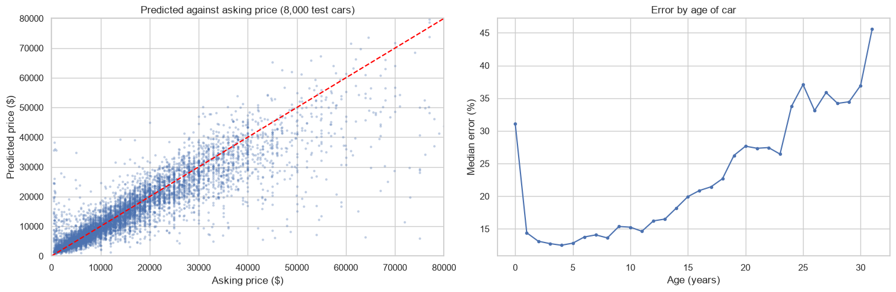
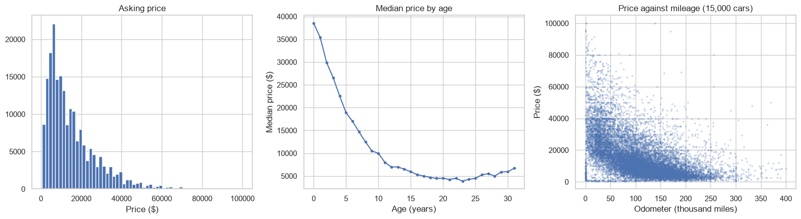

# What is a used car worth? Pricing Craigslist listings

[](https://github.com/Sammyjoseph999/used-car-prices/actions/workflows/tests.yml)

A model that estimates the asking price of a used car from its Craigslist listing, built on about 427,000 US listings from April and May 2021. Most of the work, and the most useful finding, is in the data cleaning.



## Findings

- **Nearly half the usable listings were reposts.** After removing listings with an impossible price, year or mileage (15% of the file), 44% of the rest were the same car posted again, usually by a dealer in another region. 426,880 listings describe 202,239 distinct cars.
- **Reposts inflate the test score.** With a random split, copies of one car land in both the training and the test set. The same model then looks three points more accurate (13% median error against 16%, R² of 0.83 against 0.77).
- **Gradient boosting is within 20% of the asking price for 59% of cars**, with a median error of about $1,700.

| Model | MAE | Median error | Within 20% of price | R² (log price) |
|---|---|---|---|---|
| Median baseline | $9,288 | 55.1% | 16.5% | 0.00 |
| Ridge regression | $4,136 | 20.4% | 49.2% | 0.66 |
| Gradient boosting | $3,248 | 16.0% | 59.2% | 0.77 |

- **Age matters most**, three times as much as mileage by permutation importance. Median price falls from about $38,000 for a new listing to under $10,000 at ten years, flattens around $4,500 at twenty, and rises again for thirty-year-old cars.
- **The model is weakest at the extremes.** It overestimates 70% of cars under $5,000 and underestimates 80% of cars over $35,000. The reasons a car is unusually cheap or expensive are mostly in the free-text description, which is not used here.



## Approach

1. **Profile** the raw listings: missing values, free-text fields, placeholder prices.
2. **Filter** to plausible listings: price $500 to $100,000, model year 1990 to 2021, mileage 100 to 400,000.
3. **Deduplicate** to one row per car, by VIN where there is one and otherwise by make, model, year, mileage and price.
4. **Prepare features**: age, mileage, and eleven categorical columns. Missing categories are kept as "unknown"; the free-text model name is normalised and limited to the 250 most common.
5. **Model** the log of price with a median baseline, ridge regression and histogram gradient boosting, all on the same 80/20 split.
6. **Analyse errors** by price band and age, and measure permutation importance.

The cleaning steps are in `usedcars/clean.py` and covered by tests.

## Running it

The data is not included (the file is 1.4 GB). It is the Craigslist used-cars scrape distributed on Kaggle as the "Used Cars Dataset". Save it as `data/craigslist_vehicles.csv`, then:

```bash
pip install -r requirements.txt
jupyter notebook notebook.ipynb
```

The notebook takes a few minutes to run and needs about 4 GB of memory.

## Tests

```bash
pip install -r requirements-test.txt
pytest
```

## Limits

- The target is the asking price, not the sale price.
- All listings are from spring 2021, when used-car prices were unusually high, so the dollar figures do not transfer to other periods.
- Deduplication relies on VIN or an exact match on five fields; a repost with an edited price counts as a different car.

## License

The code is released under the [MIT License](LICENSE). Datasets keep the terms of their original sources, described above.
